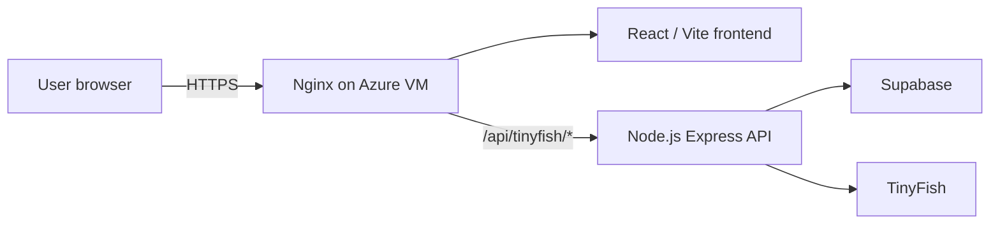
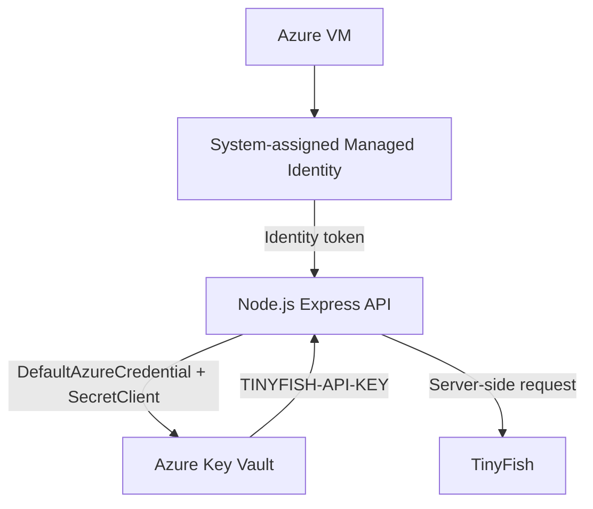

<h1 align="center">Togetherly Azure Platform</h1>

  <strong>A versioned Azure cloud engineering project focused on secure application hosting, identity, secrets management and cloud governance.</strong>
   
  Built around the Togetherly Workforce application, with each version adding a practical layer of cloud engineering.

  
  
  
  
  

---

## Project overview

Togetherly Azure Platform is a hands-on cloud engineering project that documents the deployment, security improvements and planned evolution of the Azure infrastructure supporting the **Togetherly Workforce** application.

The project began with a working VM-based application deployment in V1. V2 built on that foundation by introducing workload identity, centralized secret storage, Key Vault access restrictions and Azure Policy governance.

This is a **cumulative, versioned project**: each milestone builds on the previous architecture, records its implementation and verification, and preserves evidence before the temporary Azure environment is removed.

> **Current status:** V1 and V2 are implemented, documented and released. The temporary Azure resource group was deleted on 10 November 2026 after configuration and evidence preservation. The repository is currently the source of truth for the completed work; the Azure environment is not running. Post-teardown checks for retained resources and delayed billing remain an operational follow-up.

## Version status

| Version | Focus | Main work | Status |
|---|---|---|---|
| **V1** | Secure application deployment | Azure VM, Ubuntu, VNet, subnet, NSG, Nginx, React/Vite, Node.js Express API, HTTPS | **Completed** |
| **V2** | Identity, secrets and governance | Managed Identity, Azure Key Vault, RBAC, Key Vault network restrictions, Azure Policy | **Completed** |
| **V3** | Hardening and operations | Network hardening, monitoring, backup and restore, patching, Azure Bicep and GitHub Actions OIDC | Planned |
| **V4** | Detection and investigation | Microsoft Sentinel, KQL, security posture checks and incident investigation | Planned |
| **V5** | Architecture and resilience | Availability, disaster recovery, RTO/RPO and Zero Trust review | Planned |

See the [version roadmap](docs/versions/) for scope and implementation records.

---

## V1 — Initial Azure application deployment

V1 established the cloud hosting foundation for Togetherly Workforce.

**Implemented components**

- Azure Virtual Network, application subnet and Network Security Group.
- Ubuntu 24.04 Linux VM in Central India.
- Nginx serving the React/Vite frontend and handling HTTPS with a Let's Encrypt TLS certificate.
- Node.js Express API running as a systemd service.
- Nginx reverse proxy forwarding `/api/tinyfish/*` requests to the API on `127.0.0.1:3001`.
- Supabase for application authentication and data.
- TinyFish integration for Search, Fetch and Agent workflows.

**V1 request path**

The API ran on the VM and was managed by systemd. Azure Functions was considered during planning but was **not deployed**.

**Evidence:** 12 sanitised V1 screenshots are available in [evidence/v1](evidence/v1/).  
**Release:** [V1.0.0](https://github.com/Faizankhan-cyber/togetherly-azure-platform/releases/tag/v1.0.0)

## V2 — Identity, secrets management and governance

V2 strengthened the existing V1 hosting architecture rather than replacing it.

**Implemented security controls**

- Enabled a system-assigned Managed Identity on the Azure VM.
- Stored the TinyFish API credential in Azure Key Vault.
- Updated the Node.js API to retrieve the secret using Azure Identity `DefaultAzureCredential` and the Key Vault `SecretClient`.
- Removed the TinyFish API key from the VM application's `.env` file.
- Assigned **Key Vault Secrets User** to the VM identity and **Key Vault Secrets Officer** to the authorised operator.
- Restricted Key Vault public network access to selected network paths, including the application VNet/subnet and an administrator IP allow-list.
- Enabled the `Microsoft.KeyVault` service endpoint on the application subnet.
- Applied the built-in tag policy for `Project=Togetherly` at resource-group scope.
- Re-tested TinyFish Search, Fetch, Agent execution and Agent status after the security changes.

**V2 verification result:** the Azure Policy scan reported **8 of 8 evaluated resources compliant** at the time of the scan. The assignment used **DoNotEnforce**, so it evaluated compliance without blocking resource operations.

**V2 secret retrieval flow**

The secret is retrieved server-side and is not sent to the browser. Key Vault uses its public endpoint with network ACL restrictions and a VNet service endpoint. **A Key Vault Private Endpoint was not deployed.**

**Evidence:** all 14 V2 screenshot files are available in [evidence/v2](evidence/v2/).  
**Release:** [V2.0.0](https://github.com/Faizankhan-cyber/togetherly-azure-platform/releases/tag/v2.0.0)

---

## Technology stack

| Area | Technologies |
|---|---|
| Cloud platform | Microsoft Azure |
| Compute | Azure Virtual Machines, Ubuntu Linux |
| Networking | Azure Virtual Network, subnet, Network Security Groups, Key Vault service endpoint |
| Web and API hosting | Nginx, Node.js, Express, systemd |
| Frontend | React, Vite |
| Identity and secrets | System-assigned Managed Identity, Azure Key Vault, Azure RBAC |
| Governance | Azure Policy |
| Application services | Supabase, TinyFish |
| Transport security | HTTPS, Let's Encrypt TLS certificates |
| Infrastructure as Code | Azure Bicep planned for V3 |
| CI/CD identity | GitHub Actions OIDC planned for V3 |

## Repository guide

| Path | Purpose |
|---|---|
| [docs/architecture](docs/architecture/) | Architecture diagrams, request flows and network design |
| [docs/versions](docs/versions/) | Version implementation records and roadmap |
| [docs/security](docs/security/) | Security reviews, controls and limitations |
| [docs/runbooks](docs/runbooks/) | Deployment, operations and cost guidance |
| [docs/preservation](docs/preservation/) | V1/V2 configuration preservation and V3 rebuild plan |
| [docs/releases](docs/releases/) | Version release notes |
| [infra](infra/) | Infrastructure records and resource inventory |
| [application](application/) | Azure-specific application deployment notes |
| [evidence](evidence/) | Sanitised, versioned implementation screenshots |

The Togetherly Workforce application source code is maintained separately in the [togetherly-workforce repository](https://github.com/Faizankhan-cyber/togetherly-workforce).

## Rebuild and cost approach

V1 and V2 were configured manually through the Azure Portal. The project follows a **build, verify, document and decommission** cycle so that cloud resources are not left running when they are not needed.

Beginning with V3, Azure Bicep is planned as the source of truth for rebuilding the completed V1/V2 infrastructure and deploying new versioned changes. GitHub Actions OIDC is also planned for Azure authentication in the V3 workflow.

The resource-group deletion was confirmed, but separately retained resources, soft-deleted Key Vault recovery state and delayed billing still need to be checked in Azure. Resource-group deletion alone does not prove that every possible resource or charge has been cleared.

## Project boundaries

- This repository contains Azure infrastructure records, architecture, documentation, version plans and implementation evidence. It is not the Togetherly Workforce application source repository.
- V1 and V2 are implementation records, not a currently running public Azure deployment.
- V2 did not include a Key Vault Private Endpoint, Azure Functions, GitHub Actions OIDC, Bicep deployment, Microsoft Sentinel or Log Analytics.
- The V2 tag policy was configured in DoNotEnforce mode; the 8/8 result is a policy compliance snapshot, not a full security audit.
- This is a learning and portfolio project, not a penetration test, independent security audit or compliance certification.

## Security

- Never commit API keys, tokens, passwords, private keys, `.env` files or raw authentication data.
- Keep TinyFish credentials server-side and retrieve them through Managed Identity.
- Review screenshots and logs before publishing; redact subscription IDs, tenant IDs, principal IDs, public IP addresses and personal information.
- Test only systems owned by the project or explicitly authorised for testing.
- Do not publish private billing information or student credit balances.

## Project links

- [GitHub repository](https://github.com/Faizankhan-cyber/togetherly-azure-platform)
- [V2.0.0 release](https://github.com/Faizankhan-cyber/togetherly-azure-platform/releases/tag/v2.0.0)
- [Togetherly Workforce application source](https://github.com/Faizankhan-cyber/togetherly-workforce)
