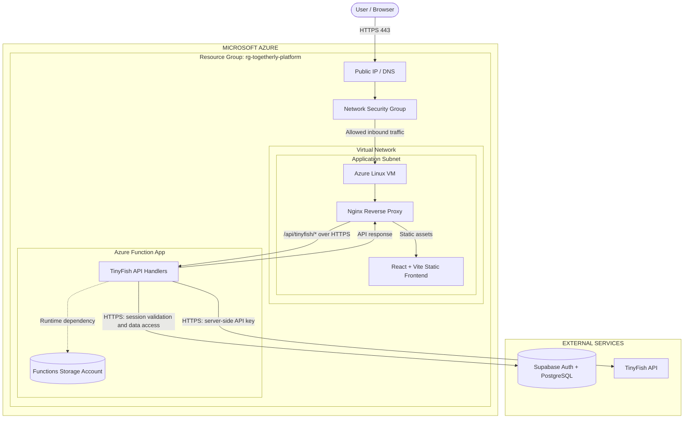

# V1 Architecture

**Status:** Proposed design, not yet deployed or validated  
**Hosting model:** Azure Portal-created infrastructure; application code deployed separately  
**Resource group:** `rg-togetherly-platform` (shared by V1–V5)

## Integrated application and infrastructure diagram

The diagram below combines the application request flow with the Azure resource and network layout. It is the single logical overview for V1.

Editable source: [V1 integrated Mermaid diagram](diagrams/v1-architecture.mmd).

## Component responsibilities

| Component | Responsibility |
|---|---|
| Azure Resource Group | Shared management boundary for the cumulative V1–V5 platform |
| Virtual Network and application subnet | Network boundary for the Linux VM |
| Network Security Group | Restrict inbound access to only the required ports |
| Public IP / DNS | Public entry point for the web application |
| Linux VM | Hosts Nginx and the built static frontend |
| Nginx | Serves frontend assets and reverse-proxies the TinyFish API path to Azure Functions |
| Azure Function App | Hosts the adapted TinyFish API endpoints using the Azure Functions Node.js programming model |
| Functions storage account | Runtime dependency for the selected Functions hosting configuration |
| Supabase | External managed authentication and PostgreSQL service |
| TinyFish | External API called by the server-side Functions |

## Request flows

### Frontend
1. The browser requests the Togetherly application over HTTPS.
2. The Azure public endpoint routes traffic through the NSG to the Linux VM.
3. Nginx serves the built React/Vite files.

### TinyFish API
1. The frontend sends a request to `/api/tinyfish/*` on the same public origin.
2. Nginx proxies that request to the Azure Function App over HTTPS.
3. The Function validates the user's Supabase session and required employee/role access.
4. The Function calls TinyFish using a server-side `TINYFISH_API_KEY`.
5. The response returns through Nginx to the browser.

## Important implementation notes

- The existing Togetherly Workforce API routes are Vercel-style serverless handlers. They are **not** a conventional Express or Node.js server.
- The handlers must be adapted and tested for the Azure Functions Node.js v4 programming model. Do not assume the existing files can be copied unchanged.
- Preserve the existing authentication, role checks, URL validation, HTTP methods, status codes, and response behaviour during the adaptation.
- Keep `TINYFISH_API_KEY` on the server side only. Never place it in Vite variables or the browser bundle.
- Supabase and TinyFish remain external services. This project does not migrate their data or change production authentication settings.
- Nginx should proxy only the required API path to the Function App. The Function App should not expose secrets in responses or logs.
- The diagram is a logical target. Actual ports, routes, hosting plan, region, DNS, TLS termination, and costs must be confirmed before deployment.
- HTTPS certificate and domain strategy must be decided before the live deployment. The public entry point must not be left serving application traffic over plain HTTP.
- V1 resources are created manually through the Azure Portal. V2 is planned to introduce Azure Bicep. Terraform is not part of this roadmap.

## Trust boundaries

1. **Internet to Azure VM:** controlled by the public IP, NSG, and Nginx.
2. **VM/Nginx to Function App:** outbound HTTPS to the Function App endpoint.
3. **Function App to Supabase:** HTTPS; user identity and application authorization must be validated server-side.
4. **Function App to TinyFish:** HTTPS using a server-side secret.
5. **Management plane:** Azure Portal access is controlled by the user's Azure identity and subscription RBAC.

## Diagram legend

- **Solid arrows:** application or network traffic.
- **Dashed arrows:** runtime dependencies.
- **Nested boundaries:** Azure resource group, virtual network, and subnet scope.

## Not shown

This diagram does not imply that CI/CD, private endpoints, a WAF, a custom domain, Azure Front Door, or production-grade high availability are included in V1. Add them only after the requirement, availability, and cost are reviewed.
