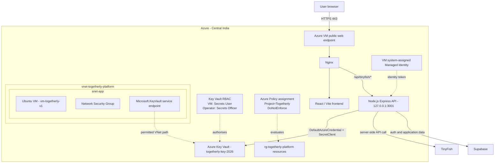

# V2 Architecture — Managed Identity, Key Vault and Governance

**Status:** Implemented and functionally verified; sanitised screenshot publication pending.  
**Deployment method:** Manual Azure Portal configuration.  
**Region:** Central India.  
**Resource group:** `rg-togetherly-platform`.

## Architecture diagram

The diagram is a logical view. The VM, Nginx, frontend and Node.js API are components on the same VM; the API is bound to loopback and is not intended to be directly reachable from the public internet.

## Request and secret retrieval flow

1. The browser accesses the frontend over HTTPS.
2. Nginx serves the frontend and forwards `/api/tinyfish/*` requests to the local Express API on `127.0.0.1:3001`.
3. The existing API authentication flow validates the user's Supabase bearer token and employee/role access.
4. For a TinyFish operation, the backend calls the shared Key Vault helper.
5. `DefaultAzureCredential` obtains a token using the VM's system-assigned Managed Identity.
6. `SecretClient` retrieves `TINYFISH-API-KEY` from the Key Vault endpoint.
7. The helper caches the retrieved value in process memory for five minutes. The value is not returned to the browser or printed in logs.
8. The backend calls TinyFish and returns the result through the authenticated application route.

## Network and trust boundaries

- The VM remains the public web entry point for HTTPS. The NSG is intended to allow web traffic and restrict SSH to an administrator source address.
- Nginx is the reverse proxy. The Node.js API listens on loopback port 3001; do not expose this port through the NSG.
- Key Vault uses its public endpoint with network ACL restrictions. The application VNet and subnet are selected, and the `Microsoft.KeyVault` service endpoint is enabled on the subnet.
- An administrator public IP allow-list entry is configured as a single-address rule. The address is intentionally not documented and may need updating if it changes.
- **There is no Key Vault Private Endpoint in V2.** A service endpoint is not the same as a Private Endpoint.
- Key Vault RBAC authorises the VM identity to read secrets. The operator's Secrets Officer role is intended for secret administration.
- Azure Policy evaluates the `Project=Togetherly` tag at resource-group scope. Its assignment is configured as `DoNotEnforce`, so it does not block resource operations.

## Components and responsibilities

| Component | Responsibility |
|---|---|
| Azure VM | Hosts Nginx and the Node.js API |
| System-assigned Managed Identity | Provides workload identity for Key Vault access |
| Azure Key Vault | Stores the TinyFish API credential |
| Key Vault Secrets User | Allows the VM identity to read secret values |
| Key Vault Secrets Officer | Allows the authorised operator to manage secrets |
| VNet service endpoint and Key Vault network ACL | Restrict the permitted network path to Key Vault |
| Azure Policy | Evaluates the required Project tag on resource-group resources |
| Supabase | Existing authentication and application data service |
| TinyFish | External web research provider |

## Explicit exclusions

The following are not part of the deployed V2 architecture:

- Key Vault Private Endpoint or private DNS zone.
- GitHub Actions OIDC federation to Azure.
- Azure Functions or a Function App.
- Bicep deployment of the V2 resources.
- Microsoft Sentinel, Log Analytics or Azure Monitor alerting.

## Verification and limitations

The VM successfully retrieved the secret without printing its value. The API service reported active/running. Search, Fetch and Agent workflows were re-tested after the Key Vault integration and network restriction. The tag policy scan reported 8 of 8 resources compliant.

These checks record implementation-time evidence. They are not a formal penetration test, independent audit or guarantee that the current live configuration has not changed. See [V2 implementation record](../versions/v2.md) and [V2 security review](../security/v2-review.md).
